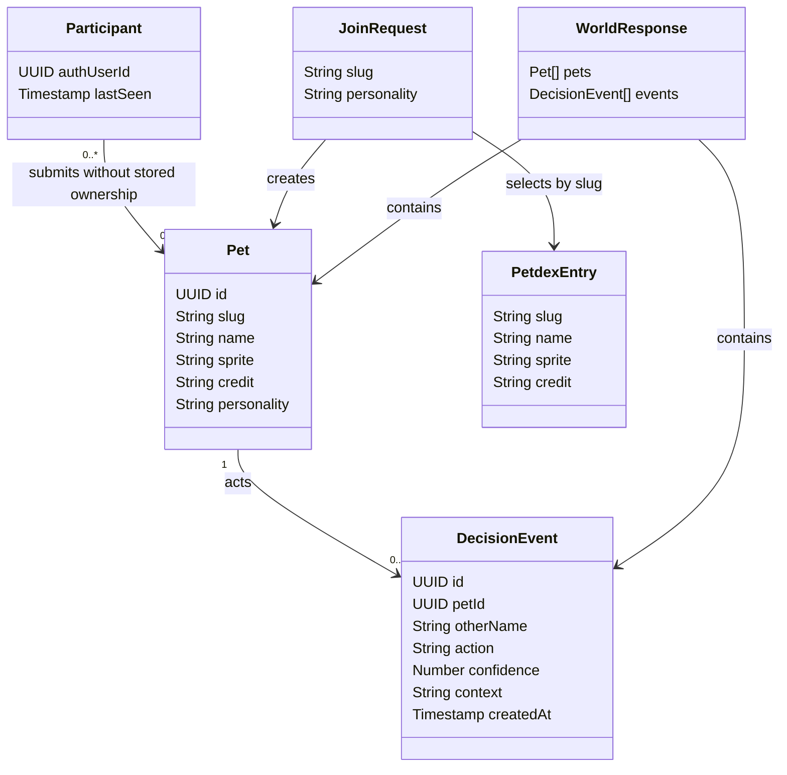

# Complete the Pet Island Hackathon Demo

## Requirements

Deliver one understandable shared journey for hackathon attendees: sign in by email, choose a real Petdex pet, set a fictional personality, and watch an actual Decisions API choice change the shared island. Make the demonstration reproducible and accessible to judges before 17:00 London time, with a public repository, credits, setup instructions, a video of at most 90 seconds, and a specific example of Codex helping build the project. Preserve the approved limit of 50 concurrent users. Prioritize completion over new simulation systems.

The approved slice uses an existing Petdex gallery selection or an uploaded Codex pet ZIP. Generated sprite sheets, long-term relationship simulation, shared objectives, and a Codex SDK runtime integration are outside this canvas. The user chose Supabase's built-in email sender. It limits the audience to organization-member email addresses; do not present the site as open to all attendees or silently change that choice.

## Entities

Participant identity is Supabase Auth; the server uses `island_presence` as a temporary admission lease. The existing schema does not store pet ownership, a target-pet ID, or event-to-event memory; do not imply otherwise. The client polls for world updates rather than subscribing to Supabase Realtime.

## Approach

1. **Complete the existing journey.** Retain the Node HTTP server, Three.js scene and Supabase tables. Use the existing Petdex manifest and same-origin sprite proxy; validate uploaded ZIP packages and persist only the sprite and required metadata. Show a persisted Decisions choice and its supplied context without inventing a model explanation.
2. **Verify real behavior.** The account has signed in; two real Petdex pets joined and a Decisions-driven greeting appeared in two tabs sharing one account. Verify a second independent account and browser, event visibility, and meaningful behavior after refresh; distinguish evidence from assumptions.
3. **Keep admission and secrets server-controlled.** Continue verifying access tokens through Supabase Auth and use the advisory-locked presence function for a maximum of 50 distinct active accounts with a two-minute lease. No service-role or OpenAI credential enters the browser or repository.
4. **Deliver within the event constraint.** Configure a single long-running Node instance, approved deployment host, provider secrets, and the exact allowed Supabase Auth redirect. Verify public HTTPS and provider access before using it in the video. Built-in email currently restricts recipients; general attendees need SMTP or another user-approved sign-in change, and remain blocked until then.
5. **Preserve honest state.** Report provider failures, full island and decision budget exhaustion accurately. The existing cap of 30 Decisions calls per process and 30-second interval is a demo guard, not a durable quota; restarting or running multiple processes resets or bypasses it.

## Structure

- `public/index.html`, `public/style.css`, and `public/app.js`: sign-in, picker, isometric world, accessible feedback, and event trace. Browser receives only the Supabase URL and publishable key.
- `server.mjs`: static delivery, verified admission, bounded catalogue and sprite access, joins, world polling, and one-process Decisions loop. Server credentials remain in environment configuration.
- `schema.sql`, `capacity.sql`, and `upload.sql`: existing tables, uploaded sprites, server-only grants, RLS and atomic admission. The live project's migrations have already been applied; avoid applying these files twice to it.
- `test/server.test.mjs`: local server-boundary tests; add targeted tests only where they protect material behavior. Supabase holds shared events and presence, not email addresses in the island tables.
- `README.md`, `LICENSE`, generated kiosk image, and this canvas: setup, provenance, MIT license, limitations, and review record. Petdex creator rights are separate from the project license.

## Operations

1. **Establish the demo baseline.** Run `npm test` and syntax checks in the repository. Start one server with local ignored environment variables; verify `GET /api/world` rejects unauthenticated visitors. Confirm the current Node runtime supports the `--env-file-if-exists` flag and correct the documented minimum if necessary. Never print keys or `.env`.
2. **Verify authentication and admission.** Use two distinct permitted organization-member email accounts in independent browser profiles. For each, complete the email link in its own profile and confirm `/api/world` succeeds. Use a transaction-rolled-back database check for 50 claims, the 51st rejection, the existing-account renewal and stale-lease expiry; test concurrent claims where practical. Do not delete real presence records. Record that the built-in sender excludes general attendees.
3. **Verify the central interaction.** In the first session choose a Petdex pet and a non-sensitive personality; verify it appears in the second session. Ensure a second pet is present. Wait for a new genuine Decisions event, check both sessions display the same action, and click the actor to inspect context and confidence. Confirm persistence after refresh. Record any sprite rendering or attribution defect and fix only defects affecting this journey.
4. **Harden the existing limits and failures for a supervised demonstration.** Exercise missing/invalid session, a full island, invalid personality, unavailable Petdex, and Decisions refusal or timeout. Ensure failures do not create fabricated events. Address only observed failures and the most consequential launch blockers: public admission remains blocked by the chosen sender; join counting is currently a non-atomic check, the source-IP throttle can treat multiple users behind one proxy as one, and a single process is required for the Decisions guard. Do not claim those constraints are robust without tests.
5. **Prepare the deployment.** Choose an available Node-compatible host with one long-running instance. Prepare a reviewable deployment configuration and cost estimate, and only provision paid resources after the required approval. Configure secrets through the host's secret manager; do not copy `.env` into the repository, image, logs, or build artifact. Set Supabase Auth's exact public redirect. Verify HTTPS, sign-in with a permitted account, Petdex images, the shared decision journey, and the deployment link from a signed-out browser. Do not claim a public demo is available before these checks pass.
6. **Complete submission materials.** Update the README to match observed behavior and current Node version requirements; document sender limitations, setup, real test results, individual Petdex creator/source attribution and the generated kiosk. Check the public GitHub link without authentication. Write and record a <=90-second walkthrough showing sign-in, pet selection, a decision and shared state; avoid personal information and credentials. Include the concrete Codex example: creating the initial server-controlled Decisions loop and detecting/fixing Petdex sprite CORS during testing.
7. **Finish the milestone.** Run appropriate tests, inspect staged changes and scan for credentials; commit and push to the specified public repository. Verify the pushed revision and check all submission links from a signed-out session. Record unresolved blockers accurately and allow time for submission before 17:00.

## Norms

- Extend the existing plain JavaScript/Node code; do not introduce framework layers, Java-specific handlers, DTO wrappers, or unrelated refactors.
- Keep provider calls and service credentials server-side. Display safe actionable errors; log only operational status without email, tokens, personalities, or raw provider payloads.
- Treat Petdex metadata and user personalities as untrusted. Use text rendering rather than HTML injection and validate bounded inputs and asset origins.
- Keep the public repository reproducible with an example environment file, SQL setup, MIT license, accurate credits and explicit known limitations. Generated assets and external pets retain their respective provenance.
- Follow the user's preference to commit and push after major milestones, after checking the actual staged contents for secrets.

## Safeguards

1. Admit at most 50 distinct active accounts via a database-serialized claim; two tabs using the same account count once and stale claims expire after two minutes.
2. Do not equate the 50-person admission cap with the separate 50-pet stored-record limit. The existing pet insert cap is not atomic under simultaneous requests; test and fix if needed before claiming it is strict.
3. Permit only confirmed Supabase Auth users into shared world and join endpoints; avoid exposing identities, bearer tokens or service credentials.
4. Keep personalities between 3 and 120 characters and tell users they are shared. Do not use real email addresses, personal data or secrets in demo content.
5. Accept only catalogue-selected sprite URLs from the Petdex asset domain; retain the same-origin proxy, image-type/size bounds, and clear failure behavior.
6. Record only an actual valid Decisions API choice among approach, wave, and explore; refusals, errors and timeouts must not create events or be described as AI decisions.
7. Keep a single Node process for the existing in-memory turn guard; no more than 30 attempted Decisions calls per process, spaced at least 30 seconds, and stop when no world request has arrived for two minutes. This does not survive restart and is not a public abuse control.
8. Do not expose the demo publicly as a general-attendee email experience while the chosen built-in sender excludes nonmembers. A public deployment URL may be reachable even when login is restricted; verify and describe both separately.
9. Confirm that the chosen pets and other assets may be used in the public demo, attribute creators, and avoid assuming MIT covers third-party assets.
10. Finish a no-more-than-90-second video, public repository, tested public link, setup instructions, and specific Codex contribution before the 17:00 London submission deadline. Do not claim the demo has been submitted until actually verified.
