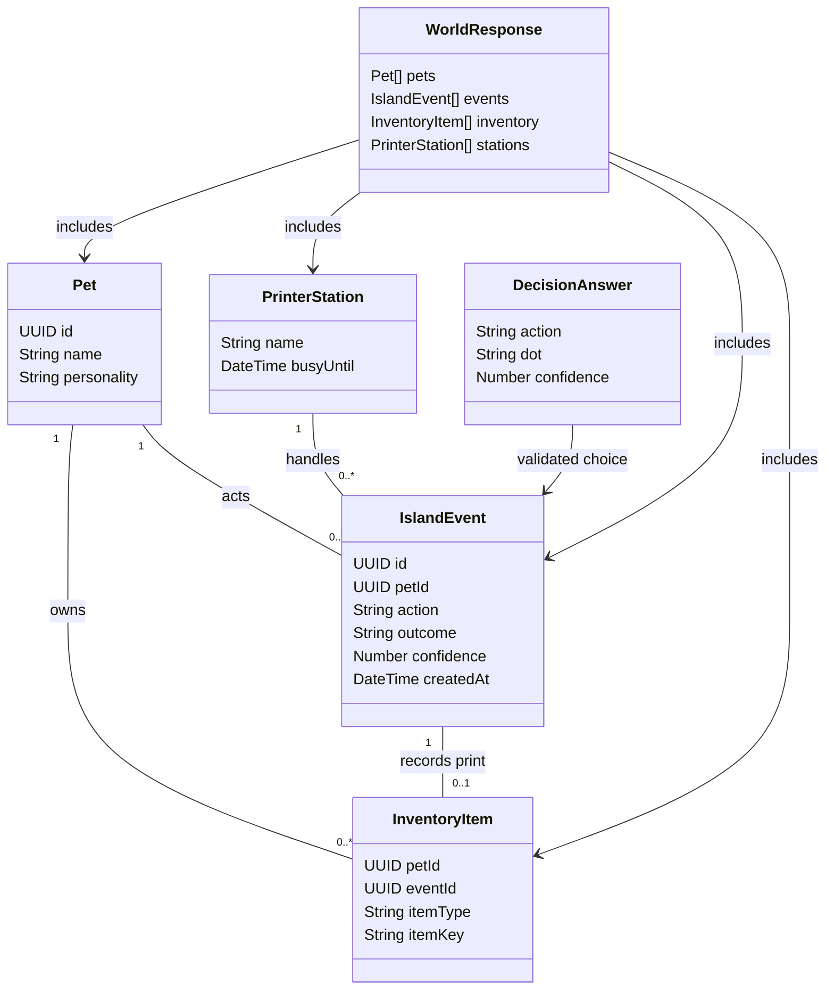

# Verify the shared printer journey

## Requirements

- Prove that a pet can receive a real Decisions API printer choice and that visitors see the same persistent print, while keeping the shared island useful for the hackathon demo.
- Exercise the full path in deterministic automated tests before spending live model calls. Keep the live run honest: do not present a fake response, manually inserted event or preselected action as a real Decisions choice.
- Preserve the existing shared-password gate, 50 active sessions, 30-second turn spacing, 30-turn-per-process cap and full-screen mobile-accessible venue.
- Limit work to verification and repairs required for this journey. The separate photo wall and plotter, food, pet needs, keynote bonuses and owner profiles remain future work.

## Entities

These are existing records and response objects, not instructions to create new classes or DTOs. Each printer event has one item; non-printer events have none. Temporary test data must stay in an isolated fake store or be transactionally rolled back.

## Approach

1. **Exercise the existing turn.** Keep the server as the authority for choosing an actor, filtering available actions, making one Decisions request, validating named answers and writing the result. Introduce the smallest internal dependency seam needed to pass a fake clock, fetch/model response and fake store to a single turn in tests; production must keep the real dependencies and have no public endpoint or setting that forces an action.
2. **Verify persistence and concurrency.** The existing `save_printer_action` function locks the printer row and atomically writes the event, dot item and 20-second busy window. Test its success and failure semantics in a rollback-only database transaction or isolated test project. Check two competing attempts and the three-dot and 12-item limits without modifying real attendee records.
3. **Verify the presentation.** The existing `/api/world` returns pets, events, inventory and stations; the browser renders the printer, figures, activity and pet details. Use two independent browser sessions, refresh both, and check the same pet, dot, event and station state. Treat browser animation as a display of server state, not a separate simulation.
4. **Use real decisions for the live check.** After the deterministic checks, use the existing shared-password flow and real credentials. Observe naturally selected actions within the existing cap and spacing. If the model does not choose the printer, report the live printer path as unverified; do not repeatedly reset the cap or fabricate a result.
5. **Handle failures honestly.** Invalid or refused choices, a busy printer, database failures and timeouts must not create a dot or a success event. Show the existing safe decision-error state and let the station become available at its recorded expiry.

## Structure

- `server.mjs`: session admission, turn scheduling, real Decisions request and `/api/world`. Extract only the minimum testable turn orchestration needed; preserve the existing HTTP error boundary and JSON error format. No Java-style controller layers or global exception class are needed.
- `printer.mjs`: existing action eligibility and answer validation; extend only if tests reveal a defect.
- `printer.sql`: source of the already-applied additive migration and transaction contract. Do not reapply it over the live schema or edit historical migrations to hide a repair; any required schema fix gets a new additive migration.
- `public/app.js`, `public/index.html`, and `public/style.css`: render real shared state and maintain the activity log, ready/in-use label, touch and keyboard access. Change only what is needed to fix a demonstrated journey defect.
- `test/`: Node test runner, isolated fake Decisions and data responses, deterministic clock and fixtures. Do not connect automated tests to the user's live Supabase project or OpenAI account.
- `README.md`: current setup and truthful test/demo instructions, including `printer.sql` after `upload.sql` and the distinction between fake automated tests and the real provider run.

## Operations

1. **Establish the baseline.** Run `npm test` and `git status --short`. Confirm the configured shared-password app loads, the printer appears and existing activity remains visible. Record that no `use_printer` event has yet been observed in the live project, unless a fresh read proves otherwise.
2. **Add a test seam for one turn.** Make a callable internal function such as `runTurn({ now, chooseActor, loadWorld, requestDecision, saveEvent, savePrint })` with explicit injected dependencies. Keep scheduling, viewer-presence gating, turn count and real production connections in the existing server entry point. The seam must not accept model choices from an HTTP request and must not enable fake decisions in production.
3. **Test a successful printer turn.** With fictional pets and a free printer, inspect the generated Decisions request: it offers `use_printer` and the three current dot choices and asks for both named answers in one request. Return a fake valid `use_printer`/`pink_dot` response, assert the printer persistence call receives the actor, matching outcome and confidence once, and verify a subsequent world response exposes the same event, item and busy state to two independent clients. Mark all fake responses as test-only.
4. **Test non-success paths.** Check that a busy station or a pet at its dot or inventory cap is not offered the printer; a malformed, refused, unoffered or unknown choice causes no write; a failed or timed-out model or database write does not report a successful print; a non-printer action never uses the dot answer. Verify only one of two concurrent claims succeeds and rollback preserves the existing database. Include old non-printer events in the response test.
5. **Check the browser and repair demonstrated defects.** Verify that the selected pet moves toward the printer, the chosen coloured figure and activity line are visible, the pet detail shows its item, and the busy label clears after the server's expiry. Verify one desktop and one phone-sized viewport, refresh and keyboard-accessible pet selection. Fix only defects that prevent those checks. Be explicit if current immediate item rendering occurs before movement completes; either align the presentation with persisted event time or describe the behavior accurately.
6. **Run the genuine shared journey.** In two independent browser profiles or devices, enter using the temporary password without displaying or recording it. Use two fictional pets with artwork the team may share. Observe up to the configured 30-turn cap, never reset it merely to force a result, and record the timestamp and matching outcome if Decisions naturally chooses the printer. Verify the event and item persist after refresh in both sessions. If it does not occur within the budget, record the result as unverified and use the deterministic test only as evidence of integration behavior.
7. **Prepare the demo.** Run `npm test` and `git diff --check`, inspect the staged diff for credentials and personal data, verify README setup order and working public links, and make a short demo outline with a concrete example of Codex's contribution. Confirm permission for dot-style figures before using that look in public. Leave sufficient time for the public repository and a video no longer than 90 seconds.

## Norms

- Follow the existing Node.js ES module, `node:test`, Three.js and server-side Supabase patterns. Prefer pure functions and dependency parameters to new frameworks, class hierarchies or packages.
- Use `async`/`await`, validate every provider answer against the actual offered values and keep all service credentials on the server. Log operational errors without passwords, cookies, service keys, personal data or raw provider payloads.
- Treat pet names and personalities as untrusted public data. Do not collect emails, imply per-owner identity, or expose the shared password in the repository, UI captures or video.
- Use fictional fixtures and deterministic time in automated tests. Do not write synthetic events into the real shared world, delete attendee data or silently bypass an approval boundary.
- Describe a model choice, deterministic game behavior and test simulation accurately; never label a fake response or confidence value as a live model decision.

## Safeguards

1. At most one production decision request per 30 seconds and 30 per server process; no decisions when the last viewer is more than two minutes old. A restart resets the existing process counter and sessions, so do not use repeated restarts to raise the effective budget.
2. No more than 50 active sessions; no pet or station state change bypasses the password gate or server-only database access. No public endpoint may force a printer decision.
3. One printer occupant during the 20-second busy period; the transactional save either commits both one event and one matching item or commits neither. Three dots and 12 total items per pet remain the limits.
4. Existing events and uploaded/Petdex pets remain readable. A missing or invalid GLB retains the island fallback; do not require the teammate's asset for the test.
5. The real printer test succeeds only if a genuine Decisions response selects a valid printer action and dot, the transaction persists, and two independent sessions see the same result after refresh. Do not equate a fake test or rolled-back database check with this live acceptance criterion.
6. If the live model does not select the printer before the budget or time is exhausted, report the remaining gap rather than expanding scope. The final demo must use rights-cleared assets, reachable links and a video no longer than 90 seconds.
