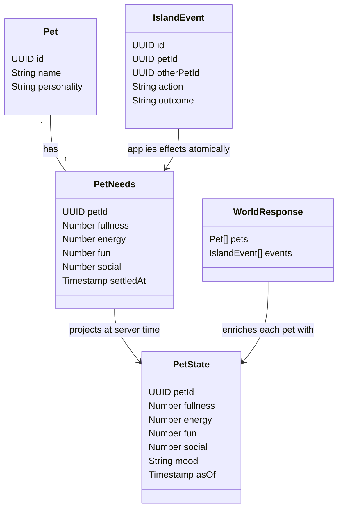

# Shared pet needs and mood

## Requirements

Give every pet a shared, understandable game state that influences its next Decisions choice and is visible in its pet card.

Implement fullness, energy, fun and social needs, time-based decay, action effects and deterministic mood. Preserve the shared-password gate, 50-session limit, existing eight actions, 10-second uncapped decision schedule, single production runner and all existing pets, events and inventory.

Exclude area/keynote bonuses, authoritative movement, inventory consumption, ownership, contact sharing, relationships, long-term memory, generated art and photo export. This draft is for review; it does not authorize deployment or migration by itself.

## Entities

These are plain records, not new application classes. Store one needs row per pet; derive mood instead of storing a second value that can disagree with the needs. Extend each existing world pet with `needs: {fullness, energy, fun, social, asOf}` and `mood`; keep all existing fields. The PetState record above describes that projection, not a separate endpoint or top-level response field.

## Approach

1. **Server-owned state.** Add an `island_pet_needs` table with `pet_id` as its primary/foreign key, four numeric values constrained to 10–100, and `settled_at`. Backfill existing pets to 70 at migration time, without replaying historical actions. Initialize new pets to 70 in the same database transaction as their insertion through a small trigger.
2. **Elapsed time, no new timer.** Project needs at one database timestamp per request: `max(10, storedValue - rate * max(0, asOf - settledAt) / 3600 seconds)`. Preserve fractional values. Reads calculate current values without updating rows. A successful action settles elapsed decay, applies its deltas, clamps to 10–100 and advances `settled_at`, all in one transaction. Round only for display. Decay continues while no visitors are watching and across server restarts; decisions still pause after the existing viewer timeout. No per-minute writes or cron jobs.
3. **Bounded game rules.** Use the following initial tuning from the existing station-actions plan. These are game mechanics, not inferred emotions.

| Need | Decay per hour | Action effects |
| --- | ---: | --- |
| Fullness | 10 | Collect food: actor +35 |
| Energy | 8 | Collect Codex Cola: actor +30; explore: actor −10 |
| Fun | 10 | Printer or plotter: actor +25; photo: both pets +20; explore: actor +15 |
| Social | 12 | Photo: both +25; message: sender +15, recipient +20; approach or wave: both +10 |

Apply gains at successful action commit, consistent with the existing immediate inventory award. Food and cola records remain collectibles; do not consume or delete them. Existing inventory eligibility and caps remain in force. A pet with 12 items cannot collect more refreshments; replenishing needs after that limit requires a later consumption design. Do not silently lift the cap.

4. **Mood rule.** If any need is below 30, use the lowest need: fullness → hungry, energy → sleepy, fun → bored, social → lonely. Break equal-value ties in that same order. Otherwise, if all four values are strictly above 75, mood is excited; otherwise happy. Compare unrounded values. At exactly 30 a need is not low; at exactly 75 it does not qualify as excited.
5. **One transaction per action.** Introduce a service-only `save_pet_turn` RPC wrapping the current save paths. Lock the affected needs rows in UUID order before existing station locks. Use existing printer/station RPCs for their event, inventory and occupancy rules; write approach/wave/explore events within the same outer transaction. Apply needs changes only after successful validation and saving. Any failure rolls back the event, item, occupancy and needs changes together. Do not automatically retry an ambiguous write response; reconcile the saved event before any replay.
6. **Use state in Decisions.** Read projected actor and partner state with the current history/inventory. Pass numeric needs and derived mood as context while preserving eligible choices and validation. Never force an action or claim that a low need guarantees the model will choose its remedy. At commit, settle against current database time, not the stale pre-request snapshot.

## Structure

- A new additive migration after `actions.sql`: needs table, backfill, new-pet trigger, projection helpers and `save_pet_turn`. Do not modify already-applied migration files.
- `turn.mjs`: read state and add it to the existing Decisions input; consolidate successful writes through the new RPC. Existing action eligibility and message moderation stay in their current modules.
- `server.mjs`: enrich `/api/world` pets from one projected state read. Retain authentication and the existing safe HTTP error boundary. Keep raw keys and database errors out of responses.
- `public/app.js` and `public/style.css`: connect the existing mood placeholder to real state; show four compact labeled meters in the pet card. Keep inventory, activity collapse and mobile layout.
- `test/`: deterministic projection, action, rollback and integration checks using fictional data. Add a disposable-database verification script for actual SQL behavior.
- `docs/station-actions-plan.md`, `docs/pet-actions.md`, `README.md`: describe the shipped rules, migration order and remaining area/consumption limitations after implementation succeeds.

## Operations

1. **Establish baseline.** Confirm current main, run existing tests, inspect the live migration history read-only, and verify current Supabase docs before implementing database features. Record the source revision. Keep live attendee data unchanged during tests.
2. **Implement the additive database contract.** Create `project_pet_needs(p_pet_ids uuid[])`, returning four projected numbers, mood and one shared `as_of`, and `save_pet_turn(p_action text, p_pet_id uuid, p_other_pet_id uuid, p_confidence double precision, p_context text, p_outcome text, p_message text, p_message_model text) returns uuid`. Use a fixed safe search path and schema-qualified relations. Revoke default function access from public/anon/authenticated; allow only server service-role access. Enable RLS and restrict the table to server access. The initialization trigger must work under the existing pet-insert privileges.
3. **Validate every write path.** Reject unknown actions, absent pets, self-partners for paired actions, invalid outcomes and out-of-range confidence. Reuse existing station/inventory validation. Settle only the actor for solo actions and both participants for paired actions; third-party pets remain untouched. Make the event and all effects atomic. A failed moderation call occurs before the RPC and writes nothing.
4. **Integrate the runner.** Keep actor/partner selection, 20-second busy exclusions, message limits and the 10-second schedule. Fetch projected state before building the input. Replace each successful action-save branch with the new RPC. Avoid keeping a legacy production path that saves an event without its needs effects. Leave no public force-action or state-edit endpoint.
5. **Integrate reads and presentation.** Project state once for `/api/world`; merge it into pets by ID. Display rounded fullness, energy, fun and social meters with labels, numerical values and accessible meter semantics. Use recognizable mood faces and a text label so color is never the only signal. The UI consumes server state, never applies gains or decay itself. Show “Not available” if state is missing; do not substitute 70 in the browser. Ensure the expanded card scrolls within the collapsible panel on a narrow phone screen.
6. **Verify.** Check default/backfilled/new pets; zero, fractional, one-hour and long offline elapsed time; floor/ceiling; every action effect and both photo participants; mood thresholds and ties; unavailable stations and full inventories; malformed/refused Decisions answers; moderation failures; rollback after a failed nested save; concurrent paired actions locking in opposite request order; two clients repeatedly reading without changing stored state; and restart/read consistency. Prove that existing inventory and event records remain unchanged by the migration. Run the existing suite plus disposable-database checks; mocks alone are insufficient proof of SQL atomicity.
7. **Release only the verified slice.** Apply the reviewed additive migration before switching the sole hosted runner to the new code. Keep the local runner disabled. Verify a natural live Decisions event and its correct needs effect in two independent sessions, refresh both, and inspect the phone layout. Do not fabricate a successful event to complete acceptance. Commit and push source, migration and accurate docs. Leave the existing demo live if migration or verification cannot finish before recording/submission time.

## Norms

- Use the existing Node ES modules, Supabase RPCs and browser DOM; no new framework, ORM or generic state engine.
- Keep tuning in one authoritative database implementation. Do not maintain a separate browser simulation or independently tuned JavaScript version.
- Preserve compatibility with historical pets/events and the current world fields. Initialization is at rollout time, not the pet's original creation time.
- Keep names and personalities as untrusted context; never turn them into SQL, HTML or runtime instructions.
- Use fractional internal values and numeric response fields. Explain game mood as a deterministic label, not model confidence or reasoning.
- Keep credentials out of source, tests, logs and screenshots. Use fictional fixtures and no destructive live-data cleanup.

## Safeguards

1. GET requests, refreshes and additional viewers cannot increase or persist needs; elapsed decay is projected without a read-side write.
2. The successful action transaction changes state once. A failed action awards nothing; expired occupancy alone does not award anything.
3. Needs stay within 10–100, start at 70, and use database time. Negative elapsed time is treated as zero.
4. Mood is reproducible from the returned numeric state and the documented threshold/tie rules.
5. Existing station reservations, 12-item/three-dot/one-portrait limits, moderation and refusal behavior remain intact. Full inventory can block replenishment; that limitation is documented, not hidden.
6. Keep one production runner, the uncapped 10-second schedule and current viewer timeout. Add no per-pet timers or extra model requests for mood.
7. This slice provides no area bonuses, consumption, ownership, social permissions or long-term memory. Those require separate designs.
8. A real-browser test must show the same shared state for two sessions; compare readings from the same snapshot or account for elapsed decay between requests.
9. The implementation is complete only after migration, SQL rollback/concurrency checks, UI checks and a real shared action pass. A mood icon alone is not completion.
